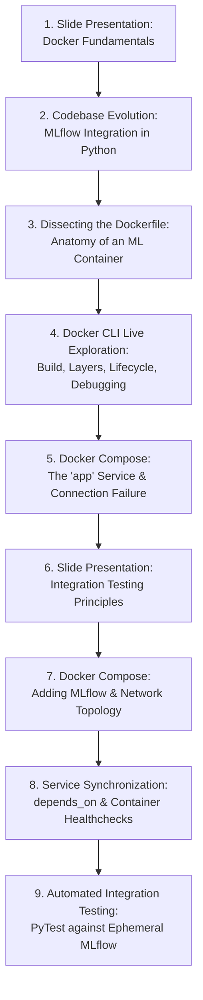
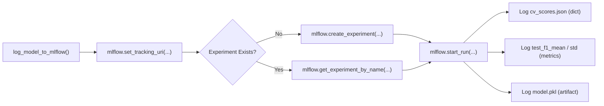
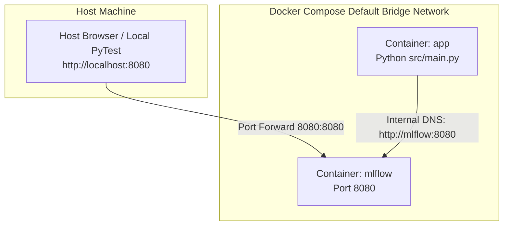

# Week 3 Course Walk-Through: Containerization, MLflow Tracking & Integration Testing

> **Course**: Machine Learning in Production (UvA)  
> **Topic**: Containerization, Multi-Service Orchestration, and Integration Testing  
> **Target Audience**: MSc AI / Data Science students  
> **Instructor Role**: Technical Educator & Tech Lead  
> **Workspace Path**: `/Users/kemalty/uva-mlprod-code`  

---

## Pedagogical Overview & Classroom Strategy

### Core Learning Objectives
By the end of this lecture and live-coding session, students will be able to:
1. **Explain the architectural role of Docker in ML systems**: Contrast abstract images (blueprints) with concrete containers (running instances), and understand how containerization eliminates "works on my machine" failures caused by native dependencies (e.g., PySpark, C-extensions, Java runtimes).
2. **Deconstruct and optimize a `Dockerfile`**: Understand layer caching mechanics, dependency isolation, environment persistence (`ENV` vs `export`), build-time vs run-time execution, and common pitfalls such as forgotten rebuilds after code edits.
3. **Master Docker CLI fundamentals**: Build, tag, inspect, stop, and debug containers interactively (`docker run -it` vs `docker exec -it`).
4. **Orchestrate dependent services using Docker Compose**: Manage multi-service topologies, configure internal container networking/DNS, and prevent race conditions using healthchecks and conditioned dependencies (`depends_on` + `service_healthy`).
5. **Implement robust integration testing for ML pipelines**: Run automated tests against live, containerized dependencies (MLflow Tracking Server) without altering production application code or polluting shared upstream infrastructure.

---

### Classroom Logistics & Multi-Terminal Setup
Before starting the lecture, set up **two terminal windows** side-by-side on your presentation screen:
* **Terminal 1 (Primary / Execution)**: For running builds, Docker Compose commands, and PyTest suites.
* **Terminal 2 (Monitor / Observation)**: For continuous container state monitoring with:
  ```bash
  watch -n 0.5 docker ps
  ```
  *(If `watch` is unavailable on macOS, use: `while true; do clear; docker ps; sleep 0.5; done`)*

---

### Master Lecture Roadmap (Flow)
This walkthrough strictly reflects the 9-stage sequence defined in [course_flow.txt](file:///Users/kemalty/uva-mlprod-code/course_flow.txt) and the detailed `# note:` markers embedded across the codebase:



---

## Stage 1: Slide Presentation — Foundations of Containerization
* **Location in Master Flow**: Step 1 in [course_flow.txt](file:///Users/kemalty/uva-mlprod-code/course_flow.txt#L1)
* **Format**: Presentation Slides (Theoretical introduction before code)

### Teaching Narrative & Talking Points
* **The Production ML Problem**: ML code doesn't live in isolated Python scripts. It requires:
  * Operating system libraries (e.g., `libgomp`, GLIBC versions).
  * External system runtimes (e.g., Java OpenJDK 17 for PySpark execution).
  * Exact Python package wheels compiled for specific CPU architectures.
* **Virtual Environments vs Containers**:
  * Python virtual environments (`venv`, `conda`) only isolate Python packages; they share the host OS, kernel, and system packages.
  * Docker containers encapsulate the entire user space: the OS filesystem, system binaries, package managers (`apt`), Python interpreter, and application source code.
* **The Core Metaphor**:
  * **Image**: The blueprint / cookie cutter (read-only, portable, versioned).
  * **Container**: The living instance / cookie (isolated process running on the host kernel with its own namespace and filesystem).

---

## Stage 2: Codebase Evolution — Highlighting MLflow Integration
* **Location in Master Flow**: Step 2 in [course_flow.txt](file:///Users/kemalty/uva-mlprod-code/course_flow.txt#L2)
* **Relevant Files**:
  * [src/main.py](file:///Users/kemalty/uva-mlprod-code/src/main.py)
  * [src/model_training.py](file:///Users/kemalty/uva-mlprod-code/src/model_training.py)
  * [configs/configs.py](file:///Users/kemalty/uva-mlprod-code/configs/configs.py)

### 1. The Main Driver Script
Open and walk students through [src/main.py](file:///Users/kemalty/uva-mlprod-code/src/main.py).

* **Code Reference**: [src/main.py lines 11–32](file:///Users/kemalty/uva-mlprod-code/src/main.py#L11-L32)
* **Key Code Symbol**: Function [`main`](file:///Users/kemalty/uva-mlprod-code/src/main.py#L11-L32)
* **What to Highlight**:
  * Point out lines 12–26: The pipeline reads transaction data with PySpark, generates features, exports to Parquet, and converts to pandas for scikit-learn training.
  * Emphasize line 30–31:
    ```python
    # note: Here is the main change! We will log our model to MLFlow. Which is basically "storing" it there.
    model.log_model_to_mlflow()
    ```
* **Speaker Note**:
  > *"Previously, our training script simply pickled the model to a local directory or printed CV scores to stdout. In production, models must be versioned, audited, and centralized. We have added `log_model_to_mlflow()`. This single method introduces an external network dependency: the MLflow Tracking Server."*

---

### 2. The Model Class & MLflow Logging Mechanics
Open and walk students through [src/model_training.py](file:///Users/kemalty/uva-mlprod-code/src/model_training.py).

* **Code Reference**: [src/model_training.py lines 48–76](file:///Users/kemalty/uva-mlprod-code/src/model_training.py#L48-L76)
* **Key Code Symbol**: Class [`Model`](file:///Users/kemalty/uva-mlprod-code/src/model_training.py#L12-L76), Method [`Model.log_model_to_mlflow`](file:///Users/kemalty/uva-mlprod-code/src/model_training.py#L48-L76)



* **Step-by-Step Code Analysis**:
  1. **Tracking Server URI** ([Line 49–50](file:///Users/kemalty/uva-mlprod-code/src/model_training.py#L49-L50)):
     ```python
     # note: We will use the Tracking Server version of MLFLow. Basically, it is a MLFlow API.
     mlflow.set_tracking_uri(RunConfig.mlflow_tracking_uri)
     ```
     *Explain that MLflow can run locally on sqlite or connect over HTTP/REST to a remote tracking server.*
  2. **Experiments** ([Line 52–57](file:///Users/kemalty/uva-mlprod-code/src/model_training.py#L52-L57)):
     ```python
     # note: In MLFlow, there are "experiments". Which holds info about experiments of the same group...
     if experiment := mlflow.get_experiment_by_name(RunConfig.experiment_name):
         mlflow_experiment_id = experiment.experiment_id
     else:
         # note: If the experiment is already there, we want to use it.
         mlflow_experiment_id = mlflow.create_experiment(RunConfig.experiment_name)
     ```
     *Experiments group related runs under a logical project name (e.g., "Alpha").*
  3. **Runs** ([Line 59–61](file:///Users/kemalty/uva-mlprod-code/src/model_training.py#L59-L61)):
     ```python
     # note: One level below of experiments, there are runs. Each experiment has one or more runs...
     with mlflow.start_run(experiment_id=mlflow_experiment_id):
     ```
     *A single execution of the pipeline producing metrics, parameters, and tags.*
  4. **Metrics vs Artifacts** ([Line 65–75](file:///Users/kemalty/uva-mlprod-code/src/model_training.py#L65-L75)):
     * Metrics: numeric time-series/scalar values (`log_metric("test_f1_mean", ...)`).
     * Artifacts: opaque files or directories (JSON reports, serialized `.pkl` models) saved via `mlflow.log_artifact(...)`.

---

### 3. Decoupling Configuration
Open and inspect [configs/configs.py](file:///Users/kemalty/uva-mlprod-code/configs/configs.py).

* **Code Reference**: [configs/configs.py lines 13–27](file:///Users/kemalty/uva-mlprod-code/configs/configs.py#L13-L27)
* **Key Code Symbol**: Dataclass [`RunConfig`](file:///Users/kemalty/uva-mlprod-code/configs/configs.py#L13-L27)
* **Crucial Instructor Note**:
  ```python
  # note: ⚠️ Do not forget to change to
  # note:     Local Run:          "http://localhost:8080"
  # note:     Docker Compose Run: "http://mlflow:8080"
  # note: See docker-compose.yaml notes.
  mlflow_tracking_uri: str = "http://localhost:8080"
  ```
* **Speaker Note**:
  > *"Notice how the URI is externalized into configuration rather than hardcoded in the model logic. Why? Because when we run on our host machine, MLflow is accessed via `localhost:8080`. But when our code runs inside a Docker container, `localhost` points to the container itself! To talk to another container, it must use the Docker network DNS name `mlflow:8080`."*

---

## Stage 3: Dissecting the Dockerfile — Step-by-Step Anatomy
* **Location in Master Flow**: Step 3 in [course_flow.txt](file:///Users/kemalty/uva-mlprod-code/course_flow.txt#L3)
* **Relevant File**: [infra/build/Dockerfile](file:///Users/kemalty/uva-mlprod-code/infra/build/Dockerfile)

Open [infra/build/Dockerfile](file:///Users/kemalty/uva-mlprod-code/infra/build/Dockerfile) and walk through each line, executing live verification commands as noted in the file.

### Step 1: Base Image & Docker Hub
* **Code Reference**: [Dockerfile lines 1–23](file:///Users/kemalty/uva-mlprod-code/infra/build/Dockerfile#L1-L23)
  ```dockerfile
  FROM python:3.13-slim-bullseye
  ```
* **Talking Points**:
  * Start with the laptop metaphor: without `FROM`, you have empty bare metal.
  * `FROM` defines the base image: pre-assembled Linux OS with Python runtime published to Docker Hub (`python` repo, `3.13-slim-bullseye` tag).
  * Syntax: `<image_name>:<tag>`.
  * Point out [Dockerfile lines 25–30](file:///Users/kemalty/uva-mlprod-code/infra/build/Dockerfile#L25-L30): this slim Debian image already contains Python, Make, and Wget.

---

### Step 2: Incremental Build & The Run Instruction
* **Code Reference**: [Dockerfile lines 32–45](file:///Users/kemalty/uva-mlprod-code/infra/build/Dockerfile#L32-L45)
  ```dockerfile
  RUN apt-get update
  RUN echo "hello world" > hello_world.txt
  ```
* **Live Command**:
  ```bash
  docker build . -t nova -f infra/build/Dockerfile --no-cache
  ```
* **Talking Points**:
  * `RUN` executes commands *during the build phase* inside an intermediate container.
  * The filesystem modifications are captured ("baked") into an image layer.
* **Live Verification**:
  ```bash
  docker run nova
  ```
* **Question for Students**: *"Why did nothing appear in the terminal?"*
  * **Answer**: We haven't defined a default command (`CMD` or `ENTRYPOINT`). Docker spun up a container, executed nothing, and stopped immediately with status 0!
* **Proof that the file was baked in**:
  ```bash
  docker run nova cat /hello_world.txt
  ```
  *(Output: `hello world`)*

---

### Step 3: Installing Non-Python System Runtimes (Java for Spark)
* **Code Reference**: [Dockerfile line 63](file:///Users/kemalty/uva-mlprod-code/infra/build/Dockerfile#L63)
  ```dockerfile
  RUN apt-get install openjdk-17-jdk --yes
  ```
* **Talking Points**:
  * PySpark requires a Java Virtual Machine (JVM). If a student installs PySpark via `pip` on a machine without Java, PySpark crashes.
  * By baking `openjdk-17-jdk` directly into the Docker image, any developer on Linux, macOS, or Windows can run the Spark pipeline without installing Java locally!

---

### Step 4: Setting the Working Directory
* **Code Reference**: [Dockerfile lines 65–72](file:///Users/kemalty/uva-mlprod-code/infra/build/Dockerfile#L65-L72)
  ```dockerfile
  WORKDIR /nova
  ```
* **Talking Points**:
  * Sets the working directory for subsequent instructions (`RUN`, `COPY`, `CMD`) and the default starting folder when a container launches.
  * Linux defaults to `/` if unset.
* **Live Verification**:
  ```bash
  docker run nova pwd
  ```
  *(Output: `/nova`)*

---

### Step 5: Copying Dependencies & The Layer Caching Strategy
* **Code Reference**: [Dockerfile lines 74–95](file:///Users/kemalty/uva-mlprod-code/infra/build/Dockerfile#L74-L95)
  ```dockerfile
  COPY ../requirements.txt .
  RUN pip install -r requirements.txt
  ```
* **Talking Points**:
  * Syntax: `COPY <local_source> <container_destination>`. Because `WORKDIR /nova` was set, `.` means `/nova/requirements.txt`.
* **Live Verification**:
  ```bash
  docker run nova head requirements.txt
  ```
* **Crucial Pitfall (The "Bake" Gotcha)**:
  * Highlight [Dockerfile lines 85–90](file:///Users/kemalty/uva-mlprod-code/infra/build/Dockerfile#L85-L90):
  > *"Docker images do not update when you edit your host files. Files are snapshot during `docker build`. If you edit `requirements.txt` or Python code and forget to run `docker build`, you will waste hours debugging stale code. Rebuilding is mandatory!"*
* **Layer Caching Optimization**:
  * Explain why `requirements.txt` is copied and installed *before* copying `src/`.
  * Dependency installation takes minutes; code changes take seconds. If code were copied first, every minor code edit would bust Docker's cache and force a complete `pip install` rerun!

---

### Step 6: Environment Variables
* **Code Reference**: [Dockerfile lines 97–102](file:///Users/kemalty/uva-mlprod-code/infra/build/Dockerfile#L97-L102)
  ```dockerfile
  ENV PYTHONPATH=/nova/
  ```
* **Talking Points**:
  * Why `ENV` instead of `RUN export PYTHONPATH=/nova/`?
  * `export` only persists for the lifetime of that single `RUN` subshell. `ENV` sets environment variables permanently into the image metadata for all future containers.

---

### Step 7: Packaging Application Code & Transition
* **Code Reference**: [Dockerfile lines 104–114](file:///Users/kemalty/uva-mlprod-code/infra/build/Dockerfile#L104-L114)
  ```dockerfile
  COPY ../src src/
  COPY ../configs configs/
  COPY ../data/trx data/trx/
  COPY ../models/.placeholder models/.placeholder
  ```
* **Status**: Complete image specification!
* **Transition Pointer**:
  ```dockerfile
  # note: 📚 Continue at --> Readme.md --> ## Where is my image?
  ```
  This bridges directly to the next stage in [README.md](file:///Users/kemalty/uva-mlprod-code/README.md#L68).

---

## Stage 4: Docker CLI in Action — Live Terminal Exploration
* **Location in Master Flow**: Step 4 in [course_flow.txt](file:///Users/kemalty/uva-mlprod-code/course_flow.txt#L4)
* **Relevant File**: [README.md](file:///Users/kemalty/uva-mlprod-code/README.md)

Follow the sections in [README.md](file:///Users/kemalty/uva-mlprod-code/README.md) to demonstrate CLI mastery live to the class.

### 1. Where Is My Image? & Image Management
* **Code Reference**: [README.md lines 68–110](file:///Users/kemalty/uva-mlprod-code/README.md#L68-L110)
* **Live Command**:
  ```bash
  docker image ls
  ```
* **Explain to Students**:
  * Docker images are not regular files you can `cd` into; they are managed internally in Docker’s local storage engine.
  * Image identification: `<REPOSITORY>:<TAG>` and unique `IMAGE ID`.
* **Pruning Dangling Images**:
  ```bash
  docker image prune
  ```
* **Tagging Nuance (`:latest`)**:
  * Review [README.md lines 122–139](file:///Users/kemalty/uva-mlprod-code/README.md#L122-L139).
  * If `-t repo:tag` is omitted or tag is left off, Docker defaults to `latest`.
  * Best practice: explicitly tag releases or stages (e.g., `nova:0.1`, `nova:v1`).

---

### 2. Understanding Layers & BuildKit Caching
* **Code Reference**: [README.md lines 141–168](file:///Users/kemalty/uva-mlprod-code/README.md#L141-L168)
* **Live Demo**:
  Run the build command again:
  ```bash
  docker build . -t nova:0.1 -f infra/build/Dockerfile
  ```
* **Point Out in Terminal Output**:
  ```text
  => CACHED [1/7] FROM docker.io/library/python:3.13-slim-bullseye...
  => CACHED [2/7] RUN apt-get update...
  ```
* **Talking Point**:
  * Docker calculates checksums for each layer. Unchanged instructions re-use the cached layer instantly (0.0s).
  * Explain why we split `RUN` commands into logical units rather than one massive script when developing.

---

### 3. Container Lifecycles & Stopping Containers
* **Code Reference**: [README.md lines 185–214](file:///Users/kemalty/uva-mlprod-code/README.md#L185-L214)
* **The 4 Container Exit Triggers**:
  1. The entrypoint / main process completes successfully.
  2. The user or orchestrator manually stops it.
  3. The internal process crashes (unhandled exception, out of memory).
  4. The host runs out of resources or terminates Docker.
* **Commands**:
  ```bash
  docker ps        # Lists currently running containers
  docker ps -a     # Lists all containers (including stopped/exited)
  docker stop <container_id>
  ```
* Emphasize: we stop *containers* (instances), not *images* (blueprints).

---

### 4. Interactive Debugging: `run -it` vs `exec -it`
* **Code Reference**: [README.md lines 215–244](file:///Users/kemalty/uva-mlprod-code/README.md#L215-L244)
* **Scenario A: Debugging a fresh container with an interactive shell**:
  ```bash
  docker run -it nova /bin/bash
  ```
  * Inside container: run `ls`, check `python --version`, inspect `/nova`.
  * Exit with `exit`.
* **Scenario B: Debugging a container that is already running (e.g., background service)**:
  * If a container is running a blocking process (like a web server or long training job), `docker run` starts a *new* container.
  * To inspect the *existing* container process:
    ```bash
    docker exec -it <container_id> /bin/bash
    ```
  * Explain that `exec` creates a secondary shell process inside the already running namespace!

---

## Stage 5: Multi-Container Orchestration — Docker Compose & The `app` Service
* **Location in Master Flow**: Step 5 in [course_flow.txt](file:///Users/kemalty/uva-mlprod-code/course_flow.txt#L5)
* **Relevant File**: [infra/docker-compose.yaml](file:///Users/kemalty/uva-mlprod-code/infra/docker-compose.yaml)

Open [infra/docker-compose.yaml](file:///Users/kemalty/uva-mlprod-code/infra/docker-compose.yaml). Ensure the lines after `app` are commented out to build understanding incrementally.

### 1. Minimal Service Definition
* **Code Reference**: [infra/docker-compose.yaml lines 1–32](file:///Users/kemalty/uva-mlprod-code/infra/docker-compose.yaml#L1-L32)
* **Talking Points**:
  * `services`: system components (databases, tracking servers, microservices).
  * Service name `app`: logical identifier and internal network hostname.
  * Starts container from `image: nova:latest`.
* **Live Demo (Bare Container)**:
  Make sure `command` is commented out, then run:
  ```bash
  docker compose -f infra/docker-compose.yaml up app
  ```
* **Observation**: Container `infra-app-1` starts and immediately exits with code 0 because no command was defined in the Dockerfile!

---

### 2. Supplying a Container Command
* **Code Reference**: [infra/docker-compose.yaml lines 33–53](file:///Users/kemalty/uva-mlprod-code/infra/docker-compose.yaml#L33-L53)
  ```yaml
  command: python src/main.py
  ```
* **Talking Points**:
  * `command` overrides any default CMD in the image and specifies the execution process.

---

### 3. The Live Failure Demonstration (Pedagogical Climax)
* **Execution**:
  1. In **Terminal 2**, keep monitoring:
     ```bash
     watch -n 0.5 docker ps
     ```
  2. In **Terminal 1**, run the app service:
     ```bash
     docker compose -f infra/docker-compose.yaml up app
     ```
* **What Happens**:
  * PySpark starts up.
  * Data preprocessing and feature engineering run.
  * Model training completes.
  * **Then everything halts...** The application attempts to connect to MLflow:
    ```python
    mlflow.set_tracking_uri(RunConfig.mlflow_tracking_uri)
    ```
  * After connection timeouts, the Python process crashes with a `ConnectionRefusedError` / `MaxRetryError`!
* **Transition Pointer**:
  ```yaml
  # note: 🚧 Move to Chapter 2 in slides: Integration Testing.
  ```
  *See [infra/docker-compose.yaml line 54](file:///Users/kemalty/uva-mlprod-code/infra/docker-compose.yaml#L54).*

---

## Stage 6: Slide Presentation — Integration Testing in ML Systems
* **Location in Master Flow**: Step 6 in [course_flow.txt](file:///Users/kemalty/uva-mlprod-code/course_flow.txt#L6)
* **Format**: Presentation Slides (Theoretical break before resolving the failure)

### Teaching Narrative & Talking Points
* **The Limits of Unit Testing**:
  * Unit tests mock external boundaries (`mock.patch("mlflow...")`).
  * Unit tests prove *your code behaves given expected responses*, but they cannot prove *the external service accepts your payload, headers, or API version*.
* **The Staging Server Anti-Pattern**:
  * Why not test against a shared staging/cloud MLflow instance?
    * Pollutes production/staging registry with test junk (`donono.pkl`, dummy experiments).
    * Requires constant internet connectivity and cloud credentials.
    * Multiple CI runs will conflict on experiment names and crash concurrently.
* **The Modern Solution: Ephemeral Local Environments**:
  * Use Docker Compose to spin up exact, reproducible copies of the real services (MLflow, PostgreSQL, Redis) locally or inside CI runners.
  * Execute integration tests against the live local container, then tear it down.

---

## Stage 7: Orchestrating the Stack — Introducing the MLflow Service
* **Location in Master Flow**: Step 7 in [course_flow.txt](file:///Users/kemalty/uva-mlprod-code/course_flow.txt#L7)
* **Relevant Files**:
  * [infra/docker-compose.yaml](file:///Users/kemalty/uva-mlprod-code/infra/docker-compose.yaml)
  * [configs/configs.py](file:///Users/kemalty/uva-mlprod-code/configs/configs.py)

Return to [infra/docker-compose.yaml](file:///Users/kemalty/uva-mlprod-code/infra/docker-compose.yaml) and uncomment the `mlflow` service.



### 1. MLflow Service Specification
* **Code Reference**: [infra/docker-compose.yaml lines 92–100](file:///Users/kemalty/uva-mlprod-code/infra/docker-compose.yaml#L92-L100)
  ```yaml
  mlflow:
    image: ghcr.io/mlflow/mlflow:v3.17.0
    command: mlflow server --host 0.0.0.0 --port 8080 --allowed-hosts *
    ports:
      - "8080:8080"
  ```
* **Talking Points**:
  * **Image**: Uses official MLflow container image from GitHub Container Registry (`ghcr.io`).
  * **`--host 0.0.0.0`**: Listens on all container network interfaces (crucial for external/inter-container access).
  * **`--allowed-hosts *`**: Note the real-world GitHub issue reference ([Dockerfile line 96](file:///Users/kemalty/uva-mlprod-code/infra/docker-compose.yaml#L96)) regarding host header verification in MLflow v3.
  * **Port Mapping `8080:8080`**: Maps port 8080 on the host to port 8080 inside the container.

---

### 2. Container Networking & The Hostname Nuance
* **Highlight [infra/docker-compose.yaml lines 77–85](file:///Users/kemalty/uva-mlprod-code/infra/docker-compose.yaml#L77-L85)**:
  * Docker Compose automatically generates an isolated bridge network and assigns DNS aliases matching service names.
  * Container-to-container: `app` must address MLflow as `http://mlflow:8080`.
  * Host-to-container: Developer on terminal or browser must address MLflow as `http://localhost:8080`.
* **Required Code Modification**:
  * Show students [configs/configs.py line 25](file:///Users/kemalty/uva-mlprod-code/configs/configs.py#L25):
    ```python
    # For Docker Compose Run:
    mlflow_tracking_uri: str = "http://mlflow:8080"
    ```

---

## Stage 8: Service Dependencies & Robust Health Checks
* **Location in Master Flow**: Step 8 in [course_flow.txt](file:///Users/kemalty/uva-mlprod-code/course_flow.txt#L8)
* **Relevant File**: [infra/docker-compose.yaml](file:///Users/kemalty/uva-mlprod-code/infra/docker-compose.yaml)

### 1. The Race Condition Problem with `depends_on`
* **Code Reference**: [infra/docker-compose.yaml lines 56–73](file:///Users/kemalty/uva-mlprod-code/infra/docker-compose.yaml#L56-L73)
* **Explain to Students**:
  * If you write only `depends_on: [mlflow]`, Docker Compose launches the `mlflow` container first and immediately starts `app`.
  * **The Trap**: A container is "started" when its process spawns, but complex applications (Java, Gunicorn, MLflow) take 5–15 seconds to bind sockets, run database migrations, and accept HTTP traffic.
  * If `app` reaches `log_model_to_mlflow()` before MLflow is ready, the run fails!

---

### 2. Implementing Health Checks
* **Code Reference**: [infra/docker-compose.yaml lines 101–119](file:///Users/kemalty/uva-mlprod-code/infra/docker-compose.yaml#L101-L119)
  ```yaml
  healthcheck:
    test: apt-get update -y && apt-get install -y curl && curl --fail http://localhost:8080 || exit 1
    retries: 3
    interval: 5s
  ```
* **How It Works**:
  * Runs a test command periodically (`interval: 5s`).
  * If HTTP GET returns 200 (exit 0), status becomes `healthy`.
  * If non-zero after 3 retries, status becomes `unhealthy`.
* **Connecting Dependency to Health**:
  ```yaml
  depends_on:
    mlflow:
      condition: service_healthy
  ```
  `app` will deliberately pause until MLflow reports `healthy`!

---

### 3. Live End-to-End Execution of the Complete Stack
Follow the 4-step checklist from [infra/docker-compose.yaml lines 86–91](file:///Users/kemalty/uva-mlprod-code/infra/docker-compose.yaml#L86-L91):

1. **Uncomment all lines** in [infra/docker-compose.yaml](file:///Users/kemalty/uva-mlprod-code/infra/docker-compose.yaml).
2. **Switch tracking URI** in [configs/configs.py](file:///Users/kemalty/uva-mlprod-code/configs/configs.py#L25) to `"http://mlflow:8080"`.
3. **Rebuild the image** (crucial reminder: code changes must be baked into the image!):
   ```bash
   make build
   # OR: docker build . -t nova -f infra/build/Dockerfile
   ```
4. **Bring up the full stack**:
   ```bash
   docker compose -f infra/docker-compose.yaml up app
   ```
5. **Observe the terminal output**:
   * MLflow starts.
   * Docker waits for healthcheck to pass.
   * `app` launches `main.py`.
   * Spark initializes, model trains, cross-validation runs, and the model is successfully logged to MLflow!
6. **Open Browser Verification**:
   * Have students open `http://localhost:8080` in their browser.
   * Show the `Alpha` experiment, the run ID, recorded `test_f1_mean`, and the uploaded `alpha.pkl` artifact!

---

## Stage 9: Automated Integration Testing with PyTest & Ephemeral MLflow
* **Location in Master Flow**: Step 9 in [course_flow.txt](file:///Users/kemalty/uva-mlprod-code/course_flow.txt#L9)
* **Relevant Files**:
  * [tests/integration/test_model_training_log_model_to_mlflow.py](file:///Users/kemalty/uva-mlprod-code/tests/integration/test_model_training_log_model_to_mlflow.py)
  * [Makefile](file:///Users/kemalty/uva-mlprod-code/Makefile)

### 1. Code Walkthrough of the Integration Test
Open [tests/integration/test_model_training_log_model_to_mlflow.py](file:///Users/kemalty/uva-mlprod-code/tests/integration/test_model_training_log_model_to_mlflow.py).

* **Code Reference**: [Lines 8–40](file:///Users/kemalty/uva-mlprod-code/tests/integration/test_model_training_log_model_to_mlflow.py#L8-L40)
* **Key Code Symbol**: Function [`test_model_training_log_model_to_mlflow`](file:///Users/kemalty/uva-mlprod-code/tests/integration/test_model_training_log_model_to_mlflow.py#L8-L40)
* **Detailed Breakdown**:
  1. **Host-to-Container URI Configuration** ([Lines 12–23](file:///Users/kemalty/uva-mlprod-code/tests/integration/test_model_training_log_model_to_mlflow.py#L12-L23)):
     ```python
     class MockRunConfig:
         mlflow_tracking_uri: str = "http://localhost:8080"
         experiment_name: str = "TextExp"
     ```
     *Explain why `localhost` is used here: the test is executed by pytest on the host machine, which communicates through the forwarded Docker port `8080`.*
  2. **Non-Invasive Mock Patching** ([Lines 24–31](file:///Users/kemalty/uva-mlprod-code/tests/integration/test_model_training_log_model_to_mlflow.py#L24-L31)):
     ```python
     with mock.patch("src.model_training.RunConfig", MockRunConfig):
         with mock.patch("src.model_training.ModelConfig", MockModelConfig):
             model = Model()
             model._model = "foo"
             model._cv_scores = {"test_f1": np.array([0.1, 0.2, 0.3])}
             model.log_model_to_mlflow()
     ```
     *Highlight line 24 note: Without changing ANY production application code, we can test the real logging workflow against live infrastructure.*
  3. **Verification via the Official MLflow Client** ([Lines 32–40](file:///Users/kemalty/uva-mlprod-code/tests/integration/test_model_training_log_model_to_mlflow.py#L32-L40)):
     ```python
     experiment = mlflow.get_experiment_by_name(MockRunConfig.experiment_name)
     assert experiment

     run_id = mlflow.search_runs(experiment.experiment_id).iloc[0]["run_id"]
     run = mlflow.get_run(run_id)
     artifacts = mlflow.artifacts.list_artifacts(run.info.artifact_uri)
     assert artifacts[0].path in ["artifacts/cv_scores.json", "artifacts/donono.pkl"]
     assert artifacts[1].path in ["artifacts/cv_scores.json", "artifacts/donono.pkl"]
     ```

---

### 2. Live Test Execution
1. **Ensure MLflow is running in the background**:
   ```bash
   docker compose -f infra/docker-compose.yaml up -d mlflow
   ```
2. **Execute PyTest**:
   ```bash
   pytest tests/integration/test_model_training_log_model_to_mlflow.py -v
   ```
   *(Or run the full test suite with coverage from [Makefile line 2](file:///Users/kemalty/uva-mlprod-code/Makefile#L2): `make test`)*
3. **Show Test Passing**: All assertions pass against the real MLflow REST server.
4. **Clean Up Environment**:
   ```bash
   docker compose -f infra/docker-compose.yaml down
   ```
   *Explain that `docker compose down` stops containers and removes the temporary network, leaving the machine clean.*

---

## Instructor Quick-Reference & Troubleshooting Guide

### Master Command Sequence
| Step | Action | Terminal Command |
|---|---|---|
| **1. Build Image** | Build container image from Dockerfile | `docker build . -t nova -f infra/build/Dockerfile` |
| **2. Test Image** | Verify baked files inside container | `docker run nova cat /hello_world.txt` |
| **3. Inspect Images** | List local images | `docker image ls` |
| **4. Clean Dangling** | Remove un-tagged layers | `docker image prune` |
| **5. Run Interactive** | Launch disposable debugging shell | `docker run -it nova /bin/bash` |
| **6. Monitor Stack** | Continuous process inspection | `watch -n 0.5 docker ps` |
| **7. Attach Shell** | Enter running container | `docker exec -it <container_id> /bin/bash` |
| **8. Start MLflow Only** | Run MLflow daemon for local test | `docker compose -f infra/docker-compose.yaml up -d mlflow` |
| **9. Run Pipeline** | Run full orchestrated pipeline | `docker compose -f infra/docker-compose.yaml up app` |
| **10. Run Tests** | Execute integration test suite | `pytest tests/integration/test_model_training_log_model_to_mlflow.py -v` |
| **11. Teardown** | Stop all containers and clean networks | `docker compose -f infra/docker-compose.yaml down` |

---

### Top 4 Classroom Traps & Rapid Fixes

#### 1. "I changed my code or config, but the container still runs the old code!"
* **Root Cause**: Docker images are immutable snapshots. Editing files on the host does not update the image unless volumes are mounted or the image is rebuilt.
* **Fix**: Run `docker build . -t nova -f infra/build/Dockerfile` (or `make build`).

#### 2. "Connection refused at `http://localhost:8080` inside the container!"
* **Root Cause**: Inside a Docker container, `localhost` refers to that specific container, not your host machine or sibling containers.
* **Fix**: Change `mlflow_tracking_uri` in [configs/configs.py](file:///Users/kemalty/uva-mlprod-code/configs/configs.py#L25) to `"http://mlflow:8080"`, then rebuild the image.

#### 3. "The integration test fails with `ConnectionRefusedError`!"
* **Root Cause**: Pytest is running on the host machine, but the MLflow container isn't running or port forwarding is disabled.
* **Fix**: Start the MLflow service with `docker compose -f infra/docker-compose.yaml up -d mlflow` and ensure `ports: ["8080:8080"]` is active.

#### 4. "Container crashes immediately on startup without error message!"
* **Root Cause**: The container lacks a running foreground process (`CMD`, `ENTRYPOINT`, or compose `command`).
* **Fix**: Check `docker ps -a` for the exit code, and provide an explicit command (e.g., `command: python src/main.py`).
